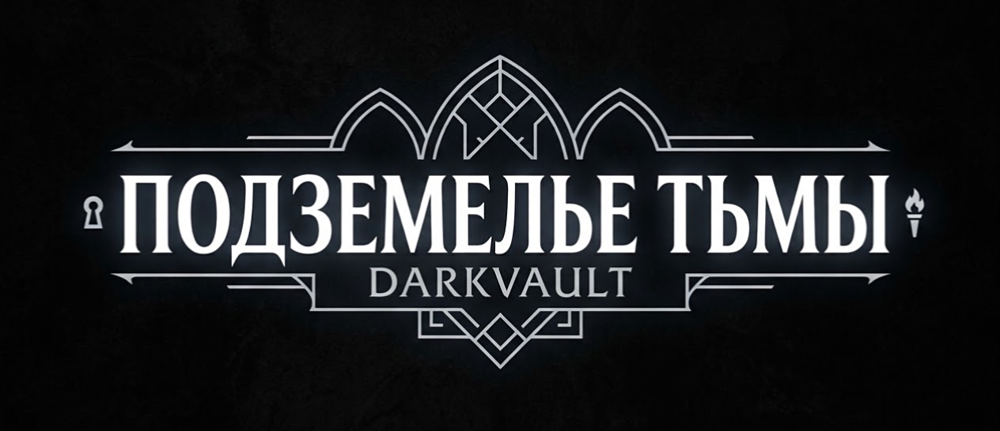

<div align="center">



# Подземелье Тьмы · DarkVault

**Процедурный монохромный нуар-рогалик на Python / Pygame с динамическим 2D-освещением и готовыми сборками для Windows, Linux и Android**


[🪟 Windows (.exe)](https://github.com/Maksim426/DARKVAULT/releases/latest/download/DarkVault.exe) • [🐧 Linux (файл)](https://github.com/Maksim426/DARKVAULT/releases/latest/download/DarkVault) • [📱 Android (.apk)](https://github.com/Maksim426/DARKVAULT/releases/latest/download/DarkVault.apk) • [Все релизы](https://github.com/Maksim426/DARKVAULT/releases/latest)

[Windows](#-windows-installer) • [Linux](#-linux-installer) • [Android (.APK)](#-android-installer-apk--сенсорное-управление) • [Запуск из исходников](#-запуск-из-исходников) • [Управление](#-управление) • [Структура](#-структура-репозитория)

</div>

---

## 📱 Скачать и установить на Android **без ПК**

1. С телефона откройте **[Releases](https://github.com/Maksim426/DARKVAULT/releases/latest)** или сразу нажмите: **[⬇️ Скачать DarkVault.apk](https://github.com/Maksim426/DARKVAULT/releases/latest/download/DarkVault.apk)**.
2. Файл скачается напрямую как готовый `.apk` — **компьютер и распаковка ZIP не нужны**.
3. Нажмите на скачанный `DarkVault.apk` и подтвердите установку.

> **Запуск без ожидания сборки (прямо на телефоне):** скачайте репозиторий (`Code → Download ZIP`), установите **Pydroid 3** из Google Play, поставьте в нём пакет `pygame`, откройте `GAME/main.py` и включите **Настройки → Сенсорное управление → ВКЛ**.

---

## 📦 Установка и сборка по платформам

Проект полностью автономен (вся графика, тени, эффекты и PCM-звук генерируются процедурно без внешних ассетов). В **[GitHub Releases](https://github.com/Maksim426/DARKVAULT/releases/latest)** публикуются **только готовые файлы запуска без установщиков**: **`DarkVault.exe`** (Windows), **`DarkVault`** (Linux) и **`DarkVault.apk`** (Android).

### 🪟 `Windows installer`
Папка: [`Windows installer/`](Windows%20installer/README.md)

1. Откройте папку `Windows installer` и запустите двойным кликом **`BUILD_WINDOWS.bat`**.
2. Скрипт сам проверит Python 3 (при необходимости установит через `winget`), установит зависимости и соберёт в `dist/windows/`:
   - **`DarkVault.exe`** — портативный `.exe`, запускается сразу без установки;
   - **`DarkVault_Setup.exe`** — графический установщик Windows (для локальной установки с ярлыками).

### 🐧 `Linux installer`
Папка: [`Linux installer/`](Linux%20installer/README.md)

1. Сборка автономного бинарника:
   ```bash
   cd "Linux installer"
   chmod +x BUILD_LINUX.sh
   ./BUILD_LINUX.sh
   ```
   Соберёт в `dist/linux/` готовый файл **`DarkVault`** и установщик **`DarkVault_Setup.sh`**.
2. Либо быстрая установка прямо из исходников (без PyInstaller):
   ```bash
   cd "Linux installer"
   chmod +x install_from_source.sh
   ./install_from_source.sh
   ```
   В обоих случаях устанавливается иконка `darkvault.png` (`hicolor` + `pixmaps`), создаётся `.desktop`-запись с `StartupWMClass=DarkVault` — **иконка DarkVault сразу появляется в меню приложений и на док-панели**, а также доступна команда `darkvault` в терминале.

### 📱 `Android installer` (`.APK` + сенсорное управление)
Папка: [`Android installer/`](Android%20installer/README.md)

1. В игру встроено полупрозрачное монохромное мультитач-управление (`touch_controls.py`):
   - **Левый динамический стик** — плавное движение на 360°;
   - **Правый стик** — прицеливание и стрельба в 4 стороны с подсветкой направления;
   - **Кнопки действий** — **Рывок** (с кругом перезарядки), **Бомба** (со счётчиком), **Реликвия** (со шкалой заряда), кнопка паузы `||` и системная кнопка «Назад»;
   - Переключатель **«Сенсорное управление: АВТО / ВКЛ / ВЫКЛ»** в Настройках.
2. **Без ПК:** скачайте готовый **`DarkVault.apk`** из **[GitHub Releases](https://github.com/Maksim426/DARKVAULT/releases/latest)**.
3. **Локальная сборка на Linux / WSL2:**
   ```bash
   cd "Android installer"
   chmod +x BUILD_ANDROID_APK.sh
   ./BUILD_ANDROID_APK.sh
   ```
   Готовый файл появится в `dist/android/DarkVault.apk`.

### ☁️ Автоматические релизы в GitHub
Workflow [`.github/workflows/build-installers.yml`](.github/workflows/build-installers.yml) при каждом обновлении автоматически собирает и прикрепляет в **[Releases](https://github.com/Maksim426/DARKVAULT/releases/latest)** только 3 готовых файла (без установщиков):
- **`DarkVault.exe`** — Windows (готовый `.exe`)
- **`DarkVault`** — Linux (готовый бинарник)
- **`DarkVault.apk`** — Android (прямая установка на телефон без ПК)

<details>
<summary>ℹ️ Где хранятся настройки и логи у установленной версии</summary>

- **Windows (`.exe`)**: `%APPDATA%\DarkVault\user_settings.json` (и `crash_log.txt` при ошибках)
- **Linux (`DarkVault`)**: `~/.config/DarkVault/user_settings.json`
- **Android (`.apk`)**: внутреннее приватное хранилище приложения (`ANDROID_PRIVATE/darkvault_data/user_settings.json`)

</details>

---

## 🚀 Запуск из исходников

```bash
git clone https://github.com/Maksim426/DARKVAULT.git
cd DARKVAULT/GAME
python -m pip install -r requirements.txt
python main.py
```

---

## 🕯️ Особенности

| Категория | Что внутри |
| :--- | :--- |
| **Визуал и свет** | Строгий чёрно-белый нуар, 4x суперсэмплинг (`Lanczos` / `Gaussian`) для героев, боссов, НПС и лавок, плавное радиальное 2D-освещение без ступенек (`lighting.py`), мягкие тени и конус фонаря |
| **Герои и артефакты** | **22 играбельных героя** со своими характеристиками и способностями, **123 артефакта** (RU / EN), быстрый инвентарь `[1–9]` / `[0]` |
| **Мир и бестиарий** | **5+ ярусов** + **Бесконечный спуск** с модификаторами, 4 топологии генерации этажей, 20+ планировок комнат с проверкой проходимости (BFS), **23 вида врагов** и **66 боссов и мини-боссов** с анимированными кат-сценами |
| **Встречи и комнаты** | 3 мистических НПС, 8 видов Нищих, 4 Торговца, 7 Автоматов, Жертвенник, Комната Кости, Древние Монолиты и Сделки Тьмы |
| **Режимы игры** | `Классика`, `Угасающий свет`, `Бесконечная бездна`, `Удвоенный хаос` и ещё 3 особых режима (всего **7 режимов**) |
| **Лор и инструменты** | Анимированная **«Хроника Подземелья Тьмы»** (12 глав), **Энциклопедия** (7 разделов), живое превью из 6 комнат в главном меню, **Консоль разработчика** и **Редактор комнат** |

---

## 🎮 Управление

### В бою
| Клавиша | Действие |
| :--- | :--- |
| <kbd>W</kbd> <kbd>A</kbd> <kbd>S</kbd> <kbd>D</kbd> | Перемещение и скольжение вдоль препятствий |
| <kbd>↑</kbd> <kbd>↓</kbd> <kbd>←</kbd> <kbd>→</kbd> | Прямые выстрелы сферами света в 4 направлениях |
| <kbd>Shift</kbd> / <kbd>C</kbd> | Теневой телепорт с кадрами неуязвимости |
| <kbd>Space</kbd> | Активация выбранной реликвии |
| <kbd>1</kbd>–<kbd>9</kbd>, <kbd>0</kbd>, <kbd>[</kbd> <kbd>]</kbd> | Выбор реликвии и переключение страниц инвентаря |
| <kbd>E</kbd> | Поставить бомбу (разрушает камни, открывает тайные комнаты) |
| <kbd>P</kbd> / <kbd>Esc</kbd> | Пауза, Энциклопедия, настройки |

### Меню, экран и консоль
| Клавиша | Действие |
| :--- | :--- |
| <kbd>A</kbd> / <kbd>D</kbd> | Выбор героя в главном меню |
| <kbd>Q</kbd> / <kbd>E</kbd> | Выбор режима игры в главном меню |
| <kbd>1</kbd>–<kbd>6</kbd> / <kbd>H</kbd> | Переключение комнат живого превью / скрыть интерфейс превью |
| <kbd>L</kbd> | Переключение языка (`Русский` / `English`) |
| <kbd>F11</kbd> / <kbd>Alt</kbd>+<kbd>Enter</kbd> | Полноэкранный / оконный режим |
| <kbd>`</kbd> / <kbd>~</kbd> / <kbd>ё</kbd> / <kbd>F1</kbd> | Консоль разработчика (предварительно включается в Настройках) |
| <kbd>F2</kbd> | Редактор комнат (активируется командой `editor on`) |

> Полный список консольных команд — в [`GAME/CONSOLE_COMMANDS.txt`](GAME/CONSOLE_COMMANDS.txt) и разделе «Консоль» внутри Энциклопедии.

---

## 📁 Структура репозитория

```text
.
├── Windows installer/                   # Всё для сборки и установки на Windows
│   ├── BUILD_WINDOWS.bat                # Сборка .EXE и установщика в один клик
│   ├── build_windows.py                 # Сборщик DarkVault.exe + DarkVault_Setup.exe
│   ├── installer_windows.py             # Графический установщик Windows (Tkinter)
│   └── README.md                        # Инструкция для Windows
├── Linux installer/                     # Всё для сборки и установки на Linux
│   ├── BUILD_LINUX.sh                   # Сборка бинарника + DarkVault_Setup.sh
│   ├── build_linux.py                   # Сборщик Linux + XDG .desktop и иконки
│   ├── install_from_source.sh           # Быстрая установка из исходников с иконкой в меню
│   └── README.md                        # Инструкция для Linux
├── Android installer/                   # Сборка Android .APK (Buildozer)
│   ├── BUILD_ANDROID_APK.sh             # Сборка DarkVault.apk в один шаг
│   ├── buildozer.spec                   # Конфигурация Android-приложения (landscape, API 34)
│   ├── prepare_android.py               # Генератор иконки (512x512), заставки и сборка APK
│   └── README.md                        # Инструкция для Android
├── GAME/                                # Исходный код игры (Python / Pygame)
│   ├── main.py                          # Главный цикл 60+ FPS, живое превью и масштабирование
│   ├── settings.py                      # Константы, темы ярусов, кеши и настройки
│   ├── lighting.py                      # Радиальное 2D-освещение, тени и конус фонаря
│   ├── dungeon.py                       # Генератор ярусов, модификаторы и 7 режимов игры
│   ├── room.py                          # 20 планировок (BFS), НПС, нищие и автоматы
│   ├── heroes.py                        # 22 играбельных героя
│   ├── player.py                        # Управление, шлейф плаща, телепорт и отдача
│   ├── enemy.py                         # 23 типа врагов и союзные спутники
│   ├── bosses.py                        # 66 боссов и мини-боссов с фазами
│   ├── items.py                         # 123 артефакта, 4x-иконки и пьедесталы
│   ├── bullet.py                        # Снаряды, слёзы и частицы
│   ├── cutscene.py                      # Портреты и кат-сцены перед боссами
│   ├── codex.py                         # Энциклопедия (7 разделов) и Хроника (12 глав)
│   ├── console.py                       # Консоль разработчика и Редактор комнат
│   ├── ui.py                            # Монохромный HUD, миникарта 5x5 и меню
│   ├── touch_controls.py                # Сенсорное мультитач-управление для Android / планшетов
│   ├── sound.py                         # Процедурный PCM-синтезатор звука
│   ├── i18n.py                          # Двуязычная локализация (RU / EN)
│   ├── build_common.py                  # Генератор иконок (.ico / .png) и база PyInstaller
│   ├── CONSOLE_COMMANDS.txt             # Справочник по командам консоли
│   └── requirements.txt                 # Зависимости (pygame, Pillow)
├── .github/workflows/
│   └── build-installers.yml             # Автосборка и публикация в Releases (Windows, Linux, Android)
├── preview.jpg                          # Обложка проекта
├── README.md                            # Описание проекта
└── LICENSE                             # Лицензия 
```
